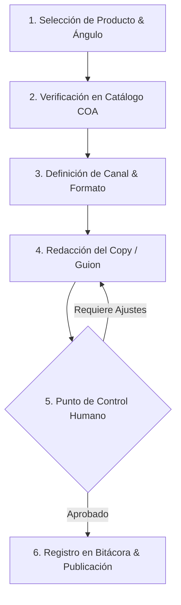

# Skill de Generación de Contenido Comercial y Técnico — BioNativa LAB

Este skill proporciona el marco metodológico, las reglas de estilo y los recursos verificados para generar piezas de marketing de contenidos de alta conversión, contenido educativo riguroso y copys comerciales para **BioNativa LAB**.

---

## 1. Arquitectura de la Skill

La skill está compuesta por tres componentes modulares:

```text
contenido-comercial-skill/
├── SKILL.md                        # Flujo de trabajo, reglas de redacción y puntos de control humano
├── references/
│   ├── catalogo_verificado.md      # Fichas técnicas oficiales de suplementos puros, miel y equipos
│   └── matriz_canales_tono.md      # Tono de marca, estructuras de guion por canal y catálogo de CTAs
└── templates/
    └── bitacora_publicaciones.csv  # Plantilla de registro para atribución de consultas y ventas
```

- [catalogo_verificado.md](./references/catalogo_verificado.md): Base de verdad técnica con purezas COA, concentraciones, precios oficiales en PEN, modos de uso y advertencias.
- [matriz_canales_tono.md](./references/matriz_canales_tono.md): Pautas de voz de marca ("Boticario Científico"), formatos específicos (TikTok, Reels, Carruseles, Facebook, WhatsApp) y fórmulas de CTAs.
- [bitacora_publicaciones.csv](./templates/bitacora_publicaciones.csv): Registro estructurado para planificar, auditar y medir el ROI de cada publicación.

---

## 2. Flujo de Trabajo Operativo Paso a Paso

Todo contenido comercial generado con esta skill debe atravesar obligatoriamente las siguientes 6 fases:



### Fase 1: Selección de Producto y Ángulo Comercial
1. Identifica el producto o pack a comunicar:
   - **Suplementos Puros:** Citrato de Magnesio, Bisglicinato de Magnesio, Creatina Monohidratada, Colágeno Hidrolizado, Proteína WPC80, Ashwagandha, etc.
   - **Miel & Derivados Apícolas:** Miel Virgen Cruda del Valle Sagrado, Propóleo 30%, Polen Multifloral.
   - **Equipamiento & Dosificadores:** Balanza digital de precisión (0.01g), Cucharas dosificadoras grado boticario, Shakers BPA-free.
2. Define la intención de la pieza:
   - *Educativa / Conciencia:* Desmontar un mito, explicar diferencias moleculares (ej. Citrato vs. Glicinato).
   - *Solución a Dolor Específico:* Insomnio, calambres nocturnos, digestión lenta, desgaste articular, estancamiento deportivo.
   - *Promocional / Directa:* Packs de ahorro de 1kg, envíos gratis, retiro en tienda Cusco o delivery Lima.

### Fase 2: Verificación Técnica de Datos
- Consulta **invariablemente** el archivo [catalogo_verificado.md](./references/catalogo_verificado.md).
- Confirma:
  - Concentración elemental y forma química exacta (ej. Citrato de Magnesio tiene 15%-16% magnesio elemental; el Bisglicinato está 100% quelado con glicina).
  - Pureza respaldada por COA (ej. Creatina 99.9% HPLC Tested; Whey Protein 80.2% proteína real).
  - Dosificación diaria recomendada y momento del día para el consumo.
  - Precio vigente en Soles Peruanos (PEN - S/) y SKU.

### Fase 3: Selección de Canal y Adaptación del Tono
- Consulta la [matriz_canales_tono.md](./references/matriz_canales_tono.md) para adoptar la estructura de contenido correspondiente:
  - **TikTok / Instagram Reels:** Gancho visual de 3 segundos + explicación fisiológica sin tecnicismos complejos + prueba visual del COA/polvo puro + CTA a WhatsApp/enlace en bio.
  - **Instagram Carrusel:** Portada estilo editorial limpio + 4-6 láminas didácticas de lectura rápida + lámina final de guardado/compartido.
  - **Facebook Post:** Redacción en tono empático y cercano para adultos y familias, testimonios de uso diario, enfoque en calidad de vida.
  - **WhatsApp Business:** Guiones de respuesta inmediata, aclaración de dudas en 3 mensajes concisos y enlace de cierre.
  - **Blog de Bienestar:** Artículos SEO/AEO profundos (800-1500 palabras) con encabezados H2/H3 y FAQs estructuradas.

### Fase 4: Redacción del Copy / Guion Publicitario
Aplica la fórmula probada de alto rendimiento de BioNativa:
1. **El Gancho (Hook):** Rompe la monotonía visual o aborda un error frecuente. *(Ej: "Si compraste citrato de magnesio para dormir mejor... elegiste la forma equivocada.")*
2. **El Problema Fisiológico:** Explica la raíz biológica del problema en palabras sencillas.
3. **La Solución BioNativa (Diferenciador COA):** Presenta la materia prima americana 100% pura, sin maltodextrina, sin colorantes ni saborizantes artificiales.
4. **La Oferta Clara & Transparente:** Formato de 1kg a precio justo de importación directa.
5. **Llamado a la Acción (CTA Comercial):** Instrucción unívoca hacia el canal de venta. *(Ej: "Pide el tuyo por WhatsApp al 981 278 458 o visita bionativalab.com con envíos nacionales vía Shalom").*

### Fase 5: Punto de Control Humano (Human-in-the-Loop)
> [!IMPORTANT]
> **Ninguna pieza de contenido comercial debe ser programada o pautada sin la validación previa de un responsable humano.**

El revisor humano debe verificar los siguientes 5 puntos de control antes de dar luz verde:
- [ ] **Exactitud Médica y Sanitaria:** No se promete curación de enfermedades graves ni diagnósticos clínicos. Cumplimiento con las normativas peruanas de complementos nutricionales.
- [ ] **Conformidad con COA:** Los datos de pureza y origen coinciden al 100% con [catalogo_verificado.md](./references/catalogo_verificado.md).
- [ ] **Precios y Stock:** El precio anunciado en Soles (S/) y la presentación (300g, 600g, 1kg) corresponden al stock disponible.
- [ ] **Canales de Contacto:** El número de WhatsApp (+51 981 278 458) y el enlace oficial (`www.bionativalab.com`) están correctamente escritos.
- [ ] **Tono de Marca:** La estética visual respeta los lineamientos del boticario natural sobrio (sin colores estridentes, sin tipografías de baja calidad, sin claims sensacionalistas).

### Fase 6: Registro en Bitácora y Medición
- Una vez aprobada y publicada la pieza, debe registrarse en [bitacora_publicaciones.csv](./templates/bitacora_publicaciones.csv).
- Completa el `id_publicacion`, fecha, canal, producto, copy/gancho y enlace.
- Transcurridas 48 a 72 horas, actualiza las métricas de **Consultas Recibidas** en WhatsApp/DM y las **Ventas Cerradas (PEN)** para medir la efectividad de cada ángulo.

---

## 3. Reglas de Formato Estrictas

1. **Lenguaje Comercial:**
   - **PROHIBIDO:** Usar términos como *"remedio milagroso"*, *"cura definitiva"*, *"adelgaza en 3 días"*, *"cura el cáncer/diabetes"*, *"fórmula mágica"*.
   - **OBLIGATORIO:** Usar terminología basada en evidencia: *"apoya la relajación neuromuscular"*, *"favorece el tránsito intestinal suave"*, *"optimiza la síntesis de ATP muscular"*, *"materia prima grado farmacéutico certificada con COA"*.
2. **Moneda y Precios:**
   - Escribir siempre los precios en Soles con el símbolo `S/` y dos decimales cuando aplique: `S/ 85.40`, `S/ 22.40`, `S/ 49.00`.
3. **Logística y Despacho:**
   - Mencionar siempre la cobertura: **Almacén central en Lima** y **Punto de distribución en Cusco (Av. Teodosio Serrudo B'10b, Urb. Coripata Sur)**.
   - Envíos a todo el Perú mediante agencias autorizadas: **Shalom** y **Marvisur**, o delivery en Lima Metropolitana.
4. **Datos de Contacto Oficiales:**
   - WhatsApp de ventas: **+51 981 278 458** (Enlace directo: `https://wa.me/51981278458`).
   - Tienda virtual: **www.bionativalab.com**.
   - Correo corporativo: **ventas@bionativalab.com**.

---

## 4. Ejemplos Rápidos de Activación

- *"Genera un guion de TikTok de 30 segundos comparando el Citrato de Magnesio y el Bisglicinato de Magnesio de BioNativa, enfocado en personas que sufren de insomnio."*
- *"Redacta un carrusel de Instagram de 5 láminas sobre por qué la Creatina Monohidratada no engorda ni retiene líquidos fuera del músculo, con CTA a WhatsApp."*
- *"Crea una plantilla de respuesta de WhatsApp para clientes que preguntan cuál es el mejor colágeno para el dolor articular en rodillas."*
