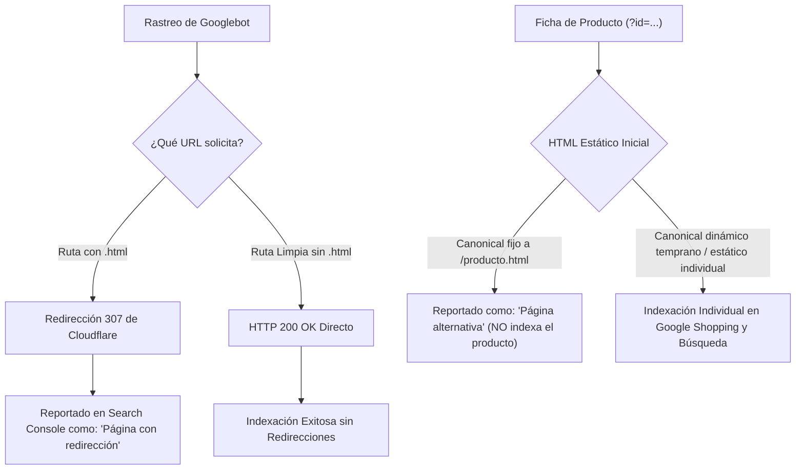

# Plan Técnico de Resolución: Indexación y Errores de Google Search Console
**Proyecto:** BioNativa LAB  
**Dominio:** `https://bionativalab.com`  
**Fecha:** 26 de Octubre, 2026  
**Autor:** Senior Full-Stack Web Engineer  

---

## 1. Diagnóstico de los Problemas Detectados en Google Search Console

Google Search Console ha emitido una alerta con dos estados de exclusión del índice:

```
1. Página con redirección
2. Página alternativa con etiqueta canónica adecuada
```

Tras realizar una auditoría técnica en tiempo real mediante solicitudes HTTP (`curl`), análisis de DNS (`nslookup`) y revisión del código fuente del proyecto, se identificaron tres causas raíces concatenadas:

### Causa Raíz 1: Redirecciones automáticas de Cloudflare Pages (Clean URLs / `.html`)
* **Qué sucede:** El archivo `sitemap.xml` y la navegación interna (`<a href="tienda.html">`, `href="nosotros.html"`, etc.) utilizan rutas con terminación `.html`.
* **Comportamiento del servidor:** Cloudflare Pages tiene activada la directiva de URLs limpias (*Clean URLs*). Cada solicitud entrante a una página `.html` (por ejemplo `https://bionativalab.com/tienda.html`) es respondida automáticamente con un código HTTP `307 Temporary Redirect` hacia la ruta limpia `/tienda`.
* **Impacto en Search Console:** Googlebot rastrea las URLs indicadas en el sitemap y en los enlaces internos, se encuentra con una redirección y las cataloga como **"Página con redirección"**, excluyéndolas del índice principal. Además, la página raíz `/index.html` es redirigida a `/`.

### Causa Raíz 2: Discrepancia de Subdominio `www` vs Apex y Fallo de DNS
* **Qué sucede:** Todo el código actual (meta tags, etiquetas canónicas, Open Graph, Schema.org y `sitemap.xml`) está configurado con `https://www.bionativalab.com/`.
* **Comportamiento del servidor y DNS:** El dominio en producción activo y asegurado con SSL en Cloudflare es el dominio raíz: `https://bionativalab.com` (sin `www`). El subdominio `www.bionativalab.com` **no cuenta con registro DNS** (genera error `NXDOMAIN` / *Non-existent domain* al consultarse en servidores públicos como Google DNS `8.8.8.8` y Cloudflare `1.1.1.1`).
* **Impacto en Search Console:** Al intentar verificar las páginas canónicas con `www`, Googlebot no puede resolverlas o las detecta como inconsistentes con el host donde se sirve el contenido.

### Causa Raíz 3: Conflicto Canónico en Fichas de Producto (`producto.html?id=...`)
* **Qué sucede:** En `producto.html`, la etiqueta canónica en el HTML estático inicial (línea 9) está fijada de manera rígida:
  ```html
  <link rel="canonical" id="canonical-url" href="https://www.bionativalab.com/producto.html" />
  ```
  Aunque un script en `producto.html` actualiza este atributo mediante JavaScript una vez que se carga la página en el navegador del cliente, los bots de Google analizan el código HTML estático inicial (First Crawling Stage) antes de la ejecución de JavaScript diferido.
* **Impacto en Search Console:** Cuando Googlebot rastrea una ficha específica (ej. `producto.html?id=citrato-de-magnesio`), lee que la URL canónica indicada es `https://www.bionativalab.com/producto.html` (la plantilla base sin parámetros). Google interpreta que la página con parámetros es un duplicado o variante y que la página oficial es la base sin parámetros. Por ende, la marca como **"Página alternativa con etiqueta canónica adecuada"** y **se niega a indexar el producto individual en los resultados de búsqueda**. Además, el `sitemap.xml` actual solo contiene 8 de los 16 productos del catálogo.

---

## 2. Arquitectura de Solución Propuesta

Para resolver ambos problemas de manera definitiva y maximizar el posicionamiento SEO y AEO (Answer Engine Optimization) de BioNativa LAB, se ejecutará el siguiente plan:



---

## 3. Plan de Acción Detallado por Fases

### Fase 1: Estandarización de Dominio Canónico (`https://bionativalab.com`)
1. **Unificar dominio base:** Reemplazar de forma masiva y consistente todas las referencias a `https://www.bionativalab.com/` por `https://bionativalab.com/` en:
   - Todas las etiquetas `<link rel="canonical">`
   - Metadatos Open Graph (`og:url`, `og:image`)
   - Metadatos Twitter Card
   - Estructuras JSON-LD de Schema.org (`WebSite`, `Organization`, `LocalBusiness`, `FAQPage`, `Product`)
   - Archivo `robots.txt`
   - Archivo `sitemap.xml`
2. **Recomendación DNS en Cloudflare:** Crear un registro `CNAME` en el panel de Cloudflare con nombre `www` apuntando a `bionativalab.com` (activando el proxy naranja de Cloudflare) y una regla de redirección 301 de `www` a non-www para que ningún usuario quede sin acceso si digita `www`.

### Fase 2: Transición a URLs Limpias (Eliminación de "Página con redirección")
1. **Actualizar `sitemap.xml`:**
   - Sustituir las URLs con `.html` por las URLs limpias canónicas finales:
     - `https://bionativalab.com/`
     - `https://bionativalab.com/tienda`
     - `https://bionativalab.com/nosotros`
     - `https://bionativalab.com/blog`
     - `https://bionativalab.com/envios-y-cobertura`
     - `https://bionativalab.com/contacto`
     - `https://bionativalab.com/terminos-y-privacidad`
     - `https://bionativalab.com/articulo-magnesio`
     - `https://bionativalab.com/articulo-creatina`
2. **Actualizar navegación interna en todos los archivos HTML:**
   - Modificar las etiquetas `<a href="...">` en Header, Menú Móvil y Footer de todas las páginas para enlazar a las rutas limpias (`href="tienda"`, `href="nosotros"`, `href="blog"`, `href="/"`, etc.), impidiendo que Googlebot sufra saltos de redirección interna innecesarios.

### Fase 3: Corrección de Indexación de Fichas de Producto
Existen dos alternativas de implementación para resolver el problema de las fichas de producto:

* **Estrategia A (Recomendada - Script Síncrono Temprano en `<head>`):**
  - En `producto.html`, ubicar un script síncrono al inicio del `<head>` que inspeccione `window.location.search`.
  - Si existe un parámetro `id`, actualizar de forma síncrona la etiqueta canónica, el `<title>` y los metadatos antes de que el parser concluya el `<head>`.
  - En el HTML estático base, eliminar el enlace canónico fijo a `producto.html` para evitar que Googlebot lo interprete como la página canónica de todas las variantes.
  - Enriquecer `sitemap.xml` con los 16 productos activos del catálogo usando la URL limpia: `https://bionativalab.com/producto?id=[id-producto]`.

* **Estrategia B (Máximo Rendimiento SEO - Generación Estática por Producto):**
  - Generar archivos estáticos individuales pre-renderizados para cada uno de los 16 productos (ej. `/producto-creatina-monohidratada.html` o similar).
  - Cada archivo contiene su propio título, descripción, schema de producto y canonical exacto sin depender de ejecución JavaScript en el bot.

### Fase 4: Solicitud de Validación en Google Search Console
Una vez desplegados los cambios:
1. Reenviar el sitemap actualizado (`https://bionativalab.com/sitemap.xml`) en la sección **Sitemaps** de Google Search Console.
2. Ingresar al informe de **Páginas no indexadas**, abrir los apartados *"Página con redirección"* y *"Página alternativa con etiqueta canónica adecuada"* y hacer clic en **"Iniciar validación"** (*Validate Fix*).
3. Inspeccionar individualmente la URL principal y una ficha de producto con la herramienta de inspección de URLs para confirmar la lectura de la etiqueta canónica correcta.
