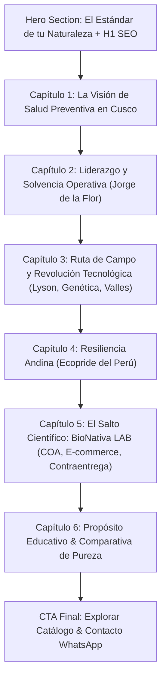

# Especificación Técnica y de Diseño: Página "Nosotros & Nuestra Historia"

## 1. Contexto y Objetivos
BioNativa LAB requiere actualizar y enriquecer su página `nosotros.html` para incorporar su historia fundacional completa:
- Desde la génesis con inversión y tecnología israelí/americana bajo **Pride of Peru S.R.L.**.
- La incorporación del fundador **Jorge de la Flor** (más de 20 años de experiencia técnica, logística, financiera y de plantas agroalimentarias).
- El trabajo de campo real en zonas estratégicas de Cusco (Pilcopata, Paucartambo, Challabamba, Yanatile, Curahuasi, Quiquijana).
- La tecnificación apícola con maquinaria europea (**Lyson**, Polonia), colmenas de madera y mejoramiento genético.
- La transición resiliente y autónoma hacia **Ecopride del Perú S.R.L.** con empuje cusqueño.
- La evolución natural hacia los suplementos nutricionales de alta pureza con **BioNativa LAB**, venta e-commerce directa a nivel nacional con pago contraentrega y una misión educativa integral.

---

## 2. Arquitectura de Información y Secciones en `nosotros.html`



---

## 3. Componentes Visuales y Estilo (Boticario Moderno / BioNativa)

1. **Línea de Tiempo Editorial ("Timeline" Cronológico):**
   - Hitos conectados por una línea dorada sutil (`#CF926B`) con insignias numéricas y fechas de evolución.
   - Alternancia visual (zigzag o tarjetas estructuradas) responsive para móvil y desktop.

2. **Slots de Imágenes Reales (Media Placeholders & Responsive Cards):**
   - Contenedores para imágenes con `aspect-ratio` óptimo (16:9 y 4:3), bordes finos con sombra orgánica (`shadow-sm`, `border-[#E8E2D8]`), `caption` explicativo y etiquetas `alt` enriquecidas para SEO.
   - Mientras se seleccionan las fotos finales desde Google Fotos o recursos locales, contarán con placeholders elegantes de estética boticaria.

3. **Insignias de Confianza E-E-A-T:**
   - Tarjetas de certificación técnica: Tecnología Lyson (Polonia), Trazabilidad COA, Cobertura Nacional Shalom/Marvisur, Pago Contraentrega Garantizado.

---

## 4. Optimización SEO y Datos Estructurados

* **Meta Title:** `Nuestra Historia: De la Apicultura Tecnificada en Cusco a Suplementos Limpios | BioNativa LAB`
* **Meta Description:** `Conoce la historia de BioNativa LAB y Ecopride del Perú: fundados por Jorge de la Flor, nacidos de la tecnificación apícola en valles cusqueños y evolucionados hacia la suplementación nutricional pura con certificado COA y envío a todo el Perú.`
* **Schema.org:**
  ```json
  {
    "@context": "https://schema.org",
    "@type": "AboutPage",
    "mainEntity": {
      "@type": "Organization",
      "name": "BioNativa LAB",
      "legalName": "Ecopride del Perú S.R.L.",
      "founder": {
        "@type": "Person",
        "name": "Jorge de la Flor",
        "jobTitle": "Fundador & Director de Operaciones",
        "description": "Contador y especialista con más de 20 años de experiencia en logística, administración, finanzas y plantas agroalimentarias."
      },
      "areaServed": "PE",
      "address": {
        "@type": "PostalAddress",
        "addressLocality": "Cusco",
        "addressCountry": "PE"
      }
    }
  }
  ```

---

## 5. Plan de Ejecución
1. Aprobación del usuario sobre este plan técnico.
2. Modificación de `nosotros.html` integrando la nueva narrativa estructurada.
3. Incorporación de fotos seleccionadas desde Google Fotos / carpeta local `img/historia`.
4. Verificación de diseño responsive y visualización en navegador.
